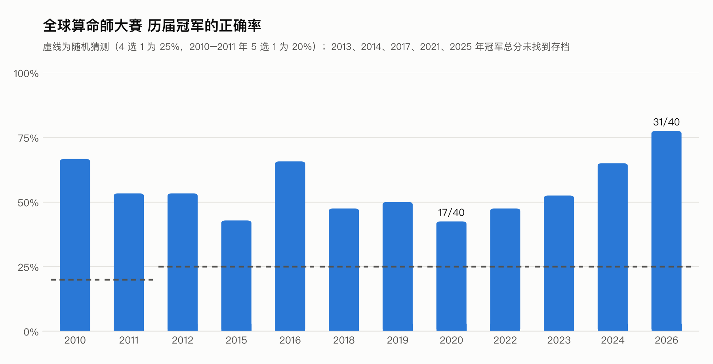

# BaziQA：全球算命師大賽 17 屆真題命理推理基準

[](LICENSE)
[](https://arxiv.org/abs/2602.12889)


**中文** | [English](README_EN.md)

BaziQA 收录香港青年術數家協會「全球算命師大賽」**2010–2026 年全部 17 届、共 555 道真题**，用来评测大语言模型的中国命理推理能力（八字为主，兼有紫微斗数、奇门遁甲）。

每道题都是专业命理师用一位真实命主出题，正确答案就是命主的真实经历。主办方每年公布答案和冠军成绩，所以这份数据既能给模型打分，也能直接和人类顶尖命理师比较。

本项目及相关论文已应用于 [AuraMate 灵伴](https://auramate.net/) 玄学陪伴产品，论文见 [arXiv:2602.12889](https://arxiv.org/abs/2602.12889)。

## ✨ 为什么用 BaziQA

- **真实、有标准答案**：117 个真实出生资料、555 道选择题，来自 17 届比赛、约 70 位命理师；答案是命主的真实人生事件，不是模型或整理者的主观判断。
- **有人类对照**：历届冠军的正确率在 43%–78% 之间，随机猜测是 25%（见下图）。模型的成绩可以直接放进人类排名里看。
- **逐题可追溯**：每道题都写明出处链接；原始网页文字、题目图片、答案表都存档在 [`sources/`](sources/)。官方答案已无存档的年份单独标注，可以一键排除。
- **排盘信息完整**：出生地、原文时间写法、时辰、出生时刻的 UTC 偏移和夏令时都已标出；117 个出生资料里有 35 个不是普通的 UTC+8。
- **开箱即评**：每个命例的八字盘和紫微盘都已排好，附排盘引擎、计分脚本和论文基线；`python tools/verify.py` 会把每道题对回原文、把每个命例对回排盘。

<picture>
  <source media="(prefers-color-scheme: dark)" srcset="docs/human_champion_accuracy_dark.png">
  
</picture>

## 🚀 快速开始

```python
import json, glob

def load(path):
    data = json.load(open(path, encoding='utf-8'))
    return data[0], data[1:]                     # 比赛元信息, 命主列表

for f in sorted(glob.glob('data/hkjfma_*.json')) + sorted(glob.glob('data/contest8_*.json')):
    meta, persons = load(f)
    q = persons[0]['questions'][0]
    print(meta['current_year'], meta['answer_source'], meta['total_questions'], '题 |', q['question'], q['options'], q['answer'])
```

每个命主带出生资料（年月日时、性别、出生地、时区）和该命例的全部题目；每道题有题干、选项和正确答案字母。

## 📊 历届真题一览

| 年份 | 届 | 命例 | 题数 | 术数构成（题数） | 答案来源 | 冠军成绩 | 文件 |
|---|---|---|---|---|---|---|---|
| 2010 | 1 | 3 | 9（5 选 1） | 未注明 | 官方 | 6/9 | `hkjfma_2010.json` |
| 2011 | 2 | 3 | 15（5 选 1） | 未注明 | 官方 | 8/15 | `hkjfma_2011.json` |
| 2012 | 3 | 3 | 15 | 未注明 | 官方 | 8/15 | `hkjfma_2012.json` |
| 2013 | 4 | 4 | 16 | 未注明 15 · 奇门 1 | 官方 | 未存档 | `hkjfma_2013.json` |
| 2014 | 5 | 7 | 35 | 八字 20 · 紫微 10 · 奇门 5 | 转载 | 未存档 | `hkjfma_2014.json` |
| 2015 | 6 | 7 | 35 | 八字 25 · 紫微 10 | 官方 | 15/35（去高低后 12/25） | `hkjfma_2015.json` |
| 2016 | 7 | 7 | 35 | 八字 25 · 紫微 10 | 官方 | 23/35（17/25） | `hkjfma_2016.json` |
| 2017 | 8 | 7 | 35 | 八字 30 · 紫微 5 | 转载 | 去高低后 12/25 | `hkjfma_2017.json` |
| 2018 | 9 | 8 | 40 | 八字 25 · 紫微 10 · 奇门 5 | 官方 | 19/40（15/30） | `hkjfma_2018.json` |
| 2019 | 10 | 8 | 40 | 八字 25 · 紫微 10 · 未注明 5 | 转载 | 20/40（15/30） | `hkjfma_2019.json` |
| 2020 | 11 | 8 | 40（第 1 命例 5 选 1） | 八字 35 · 紫微 5 | 转载 | 17/40（13/30） | `hkjfma_2020.json` |
| 2021 | 12 | 8 | 40 | 八字 20 · 紫微 20 | 转载 | 未存档 | `contest8_2021.json` |
| 2022 | 13 | 8 | 40 | 八字 5 · 未注明 35 | 官方 | 19/40（16/30） | `contest8_2022.json` |
| 2023 | 14 | 8 | 40 | 八字 20 · 紫微 20 | 官方 | 21/40（15/30） | `contest8_2023.json` |
| 2024 | 15 | 8 | 40 | 八字 15 · 紫微 10 · 未注明 15 | 官方 | 26/40（20/30） | `contest8_2024.json` |
| 2025 | 16 | 8 | 40 | 八字 25 · 紫微 15 | 官方 | 未存档 | `contest8_2025.json` |
| 2026 | 17 | 8 | 40 | 八字 20 · 紫微 5 · 未注明 15 | 官方 | 31/40（23/30） | `contest8_2026.json` |

- **选项**：除标注的年份外，每题 4 个选项（随机猜测 25%）。
- **术数构成**：出题老师所用的术数。原文没写的标「未注明」；只评测八字时，可按 `setter.method` 过滤。
- **答案来源**：「官方」是主办方公布的答案（365 题）。「转载」是官方答案已无存档、取自转载站的答案（190 题）；这个转载站与所有能对上的官方答案逐题比对，283 题全部一致，详见 [`sources/README.md`](sources/README.md)。
- **冠军成绩**：主办方公布的冠军答对题数。2014 年起采用「跳水式」计分（去掉得分最高、2015 年起还去掉最低的命例），括号内为去掉后的成绩。

| 部分 | 命主 | 题目 |
|---|---|---|
| 历届真题 2010–2026 | 117 | 555 |
| Celebrity50（50 位名人） | 50 | 488 |
| **合计** | **167** | **1043** |

## 📈 模型成绩

论文在 2021–2025 年 200 题上的结果（数据为 v1.0.0 版本；每年运行 5 次取平均，再对 5 年取宏平均，不去高低分；口径见 [`benchmark_report.md`](benchmark_report.md) 第 1.3 节）：

| 模型 | 方法 | 平均准确率 |
|------|------|-----------|
| DeepSeek-Chat-v3 | Structured | 38.00% |
| DeepSeek-Chat-v3 | Multi-turn | 36.70% |
| DeepSeek-R1 | Structured | 35.00% |
| DeepSeek-R1 | Multi-turn | 34.10% |
| GPT-5.1-Chat | Multi-turn | 32.50% |
| Gemini-2.5-Flash | Multi-turn | 32.40% |
| Gemini-3-Pro | Multi-turn | 32.10% |

同一时期有存档的人类冠军正确率为 48%–65%（2022–2024 年）。详细方法见论文。欢迎提交你的模型成绩（开 Issue 或 PR），请注明数据版本、年份范围、运行次数和是否去高低分。

## 🧪 数据质量与版本

**v2（当前版本）对全部 555 题做了逐字核对。** 每道题都按最原始的来源重新转写：优先用官方题图和官方网页原文，没有官方原件时用逐字转载并交叉核对。转写稿保留繁体原文，JSON 统一转成简体。

论文所用的 2021–2025 年原始发布版（v1.0.0）在这次核对中发现：

| 问题 | 数量 | 例子（v1 → 原题） |
|---|---|---|
| 改变题意的文字错误 | 32 处，涉及 22 题；其中 9 处在正确答案选项或题干上 | 2025 Q36 B「小学**肄业**」→「小学**毕业**」；2025 Q17 D「交通意外，**入院手术**」→「交通意外，**人平安**」；2024 Q26 D 整项内容与原题不同 |
| 命例错误 | 2 个命例（10 题） | 2024 第 4 命例时辰「午时」→「**丑时**」；2024 第 5 命例「男命」→「**坤命**（女）」 |
| 措辞改写，题意不变 | 187 处 | 「此男外地人、本身有老婆」被缩写为「对方外地人且已婚」 |
| 只给时辰却记成时辰起点 | 13 个命例 | 「巳时」记成 09:00，按真太阳时校正后会跨入辰时；v2 统一取时辰中点（另有 4 个记在半点的也一并调整） |

答案键没有错误：2022–2025 年逐题对过官方答案表。

- **复现论文结果**请用 [`v1.0.0`](https://github.com/ChenJiangxi/BaziQA/tree/v1.0.0/data) 标签下的数据；新实验请用当前版本。
- 2021–2025 年的命主 ID 和题目 ID 沿用 v1，只有 2024 年第 5 命例因性别更正改为 `female_19710412_P005`。
- 每年 JSON 的 `corrections` 字段列出了对原文笔误的修正；[`sources/README.md`](sources/README.md) 写明每年的出处、取舍依据和核对结果。

## 📋 数据格式

所有 `contest8_*.json` 与 `hkjfma_*.json` 结构相同：JSON 数组，第 0 个元素是比赛元信息，其后每个元素是一个命主（出生资料）。

```json
{
  "person_id": "2018_C5_female_19401013",
  "name": "1940年台湾出生女性",
  "case_no": "5",
  "profile": {
    "birth": {
      "year": 1940, "month": 10, "day": 13, "hour": 14, "minute": 0,
      "place": "台湾", "approximate": true, "time_raw": "未时",
      "timezone": "Asia/Taipei", "utc_offset": "+09:00", "dst": false,
      "raw": "台湾出生女命:公历1940年10月13日 未时（命例问题提供:台湾 子平八字 陈开通师傅）"
    },
    "gender": "female"
  },
  "setter": {"name": "陈开通", "method": "子平八字"},
  "context": [],
  "notes": ["官网原文漏印此命例的出生资料……"],
  "questions": [
    {"question_id": "2018_C5_female_19401013-Q21", "question_no": 21,
     "question": "此命的出身家庭及学历文化?",
     "options": ["A. 出身富裕家庭, 大学毕业", "B. 出身富裕家庭, 中学未毕业", "C. 出身贫穷家庭, 大学毕业", "D. 出身贫穷家庭, 中学未毕业"],
     "answer": "D"}
  ]
}
```

| 字段 | 说明 |
|---|---|
| `answer_source`（元信息） | `official` 官方答案，`secondary` 转载答案 |
| `sources` / `corrections` / `scoring`（元信息） | 题目和答案的出处链接、对原文笔误的修正、当年计分规则 |
| `case_no` | 命例编号。一位老师给两个出生资料时拆成 `7a`/`7b` 两个命主，按官方计分时合并为一个命例 |
| `birth.time_raw` / `birth.approximate` | 原文的时间写法；`approximate: true` 表示原文只给到时辰或时间区间，`hour` 取中点（子=0、丑=2……亥=22） |
| `birth.timezone` / `utc_offset` / `dst` | 出生地时区、出生时刻实际使用的 UTC 偏移、是否夏令时（按 IANA 时区数据库计算；出生地不明时为 `null`） |
| `setter` | 出题老师与所用术数（原文未写则为 `null`） |
| `context` | 出题老师随题附上的已知信息（定盘资料、生平事件、「使用天盘」等），作答时应一并交给模型 |
| `notes` | 整理者备注，如生辰补录的依据 |
| `question_no` / `accepted_answers` | 当年题号（与官方答案表一致）；官方认可多个答案时出现（2015 年第 18 题：B 或 D） |

**需要特别处理的题目**
- 2013 年第 16 题给出一串生平事件，要求反推出生时辰，所以该命主 `hour` 为 `null`。
- 2019 年第 8 命例是两位同年同月同日同时出生、分别生于香港和广东中山的女性，题目问「此命两人」。
- 2010、2011 年全部题目和 2020 年第 1–5 题有 5 个选项，随机正确率 20%。
- 2022 年第 1 命例生于美国，原文只写「美国当地时间」，没有时区。

### Celebrity50 格式（另一部分数据）

Celebrity50包含50位名人的详细信息：

```json
[
  {
    "person_id": "albert_ii_prince_of_monaco_P001",
    "name": "Albert II, Prince of Monaco",
    "profile": {
      "birth": {
        "year": 1958,
        "month": 3,
        "day": 14,
        "hour": 12,
        "minute": 0,
        "place": "Monaco, Monaco",
        "approximate": false
      },
      "gender": "male"
    },
    "categories": {
      "感情": ["详细的感情事件时间线..."],
      "财富": ["详细的财富事件时间线..."],
      "六亲": ["详细的家庭关系事件..."],
      "事业": ["详细的事业事件时间线..."],
      "健康": ["详细的健康事件..."]
    },
    "questions": [
      {
        "question_id": "albert_ii_prince_of_monaco_P001-Q1",
        "question": "此人在哪一年结婚？",
        "options": ["A. 2010", "B. 2011", "C. 2012", "D. 2013"],
        "answer": "B"
      }
    ]
  }
]
```

## 🧮 排盘与评测

所有命例都已排好盘，评测工具可以直接用：

| 目录 | 内容 |
|---|---|
| [`charts/`](charts/) | 全部 117 个命例的**八字盘**和**紫微斗数盘**。八字含四柱十神、藏干、纳音、十二长生、起运、大运、流年；紫微含十二宫星曜、亮度、四化、大限 |
| [`paipan/`](paipan/) | 排盘引擎：八字用 lunar-python，紫微用 iztro，均为 MIT 开源。还有出生时间换算：去夏令时、历史时区、真太阳时。[口径说明](paipan/README.md) |
| [`eval/`](eval/) | 计分脚本 `score.py`、论文多轮问答基线 `run_baseline.py`、评测口径。[说明](eval/README.md) |

```bash
pip install -r requirements.txt
python eval/run_baseline.py --files contest8_2026 --dry-run          # 看模型会收到的提示词
python eval/run_baseline.py --files contest8_2025 contest8_2026 --model <模型> --base-url <接口> --runs 3 --out preds.jsonl
python eval/score.py preds.jsonl                                    # 默认赛道 2021–2026，宏平均 + 官方去高低分成绩
```

报告成绩时请写明数据版本、赛道、运行次数、排盘口径和是否附紫微盘，详见 [`eval/README.md`](eval/README.md)。

**排盘口径**：默认用原文给的时辰；原文给了钟点的，扣掉当时的夏令时。另附原样钟点和真太阳时两种口径。117 个命例中有 12 个的时柱会因口径不同而变化，数据里已标出。八字和紫微两个引擎各自算出的日柱、时柱，除 5 个晚子时命例（两派换日时刻不同）外全部一致。

**计分规则**逐年不同（见元信息 `scoring`）：2010–2013 年按答对题数；2014 年只去掉最高分命例；2015–2017 年最高、最低各去一个，剩 5 个命例；2018 年起去掉最高、最低后剩 6 个命例共 30 题。`score.py` 已按年实现。

## 🛠 重新生成与自查

```bash
pip install opencc lunar-python
python tools/build.py data      # tools/src/YYYY.md（逐题转写稿，繁体）→ data/*.json（简体）
python tools/verify.py          # 文字对原文、选项顺序、命例对排盘，三项检查
```

`verify.py` 会把每个题干和选项放回原文中查找，检查选项是否按 A→E 落在本题范围内；还会用排盘库重算原文印出的四柱、农历日期、年柱提示和大运起运年份，与命例字段比对。当前三项全部通过。

## 🎯 研究用途

大模型的领域知识与多步推理评估、中文传统文化理解、命理推理方法（prompt、RAG、微调）的对照实验、人机对比研究。

## 📄 引用

```bibtex
@dataset{bazi_QA,
  title={BaZi Fortune-Telling QA Dataset},
  author={Jiangxi Chen},
  year={2025},
  publisher={GitHub},
  url={https://github.com/ChenJiangxi/BaziQA}
}
```

## 📜 许可证

整理、转写、元数据与代码采用 [MIT License](LICENSE)。题目原文版权归香港青年術數家協會及各出题老师所有，本仓库为学术研究目的收录并逐题注明出处；如需商业使用题目原文，请联系主办方。

## ⚠️ 免责声明

1. **科研用途**：本数据集仅用于学术研究和 AI 评估，不构成任何形式的命理建议。
2. **隐私保护**：比赛命主由主办方匿名发布，名人信息来自公开资料。
3. **文化尊重**：八字命理是中国传统文化的一部分，使用时请尊重文化传统。
4. **结果解释**：AI 模型的预测结果不应被视为专业的命理咨询。

## 🤝 贡献与联系

发现数据错误或有改进建议，请在 [Issues](https://github.com/ChenJiangxi/BaziQA/issues) 提出，或提交 Pull Request（请附出处）。

- [AuraMate 灵伴](https://auramate.net/)
- [论文 arXiv:2602.12889](https://arxiv.org/abs/2602.12889)

## 📊 更新日志

### v2.2.0（2026-10-20，排盘与评测公开）
- ✅ 新增 `charts/`：全部 117 个命例的八字盘与紫微斗数盘，含三种出生时间口径
- ✅ 新增 `paipan/` 排盘引擎（lunar-python + iztro）与 `eval/` 评测工具（计分、论文多轮基线、评测口径）
- 📝 修正 README 中论文成绩的统计口径说明（每年 5 次运行取平均，再对 5 年取宏平均）

### v2.1.0（2026-10-20，深度核对）
- 🔧 2021–2025 年按官方题图、官方网页原文和逐字转载重新转写，修正 32 处改变题意的文字错误和 2 个命例错误（详见「数据质量与版本」）；论文所用原版保留为 `v1.0.0` 标签
- ✅ 全部出生资料新增 `timezone`、`utc_offset`、`dst`（夏令时）；只给时辰的命例统一取时辰中点
- ✅ `tools/verify.py` 覆盖 2010–2024 年文字核对和 2010–2026 年命例核对；2025、2026 年对照原图逐字核对
- ✅ 新增 2021–2026 年官方题图、答案表和转载原文存档；新增冠军成绩图、英文 README、LICENSE

### v2.0.1（2026-10-20）
- 🔧 2026 年第 16、19 题改回原图用字；去掉原图没有写、由整理者推断的术数和出生地

### v2.0.0（2026-10-20）
- ✅ 新增第 1–11 届（2010–2020）全部 315 题、第 17 届（2026）40 题；新增 `sources/` 出处存档与 `tools/` 转写稿
- 📝 更正文档数字：Celebrity50 实为 488 题（v1.0.0 文档写成 250）

### v1.0.0（2025-02）
- 🎉 初始发布：Contest8 2021–2025（200 题）与 Celebrity50；论文实验所用版本

---

**最后更新**：2026 年 10 月 20 日
